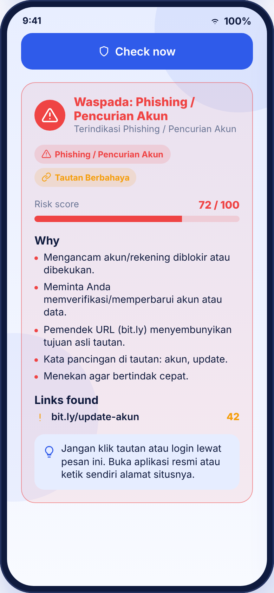
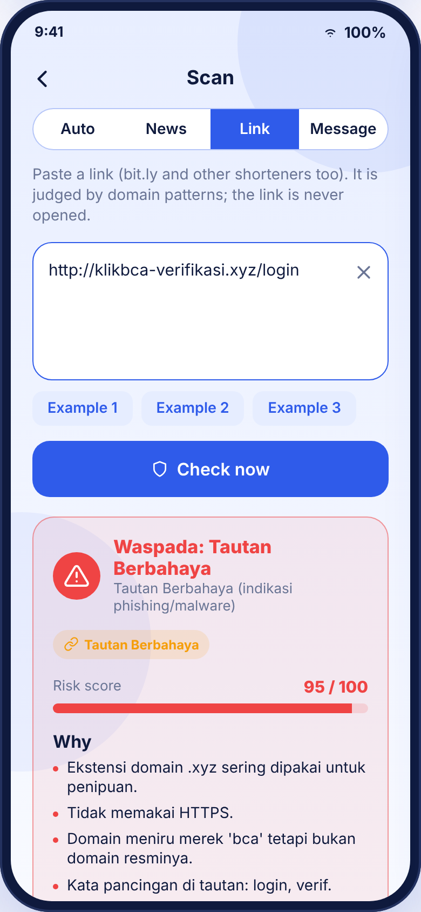
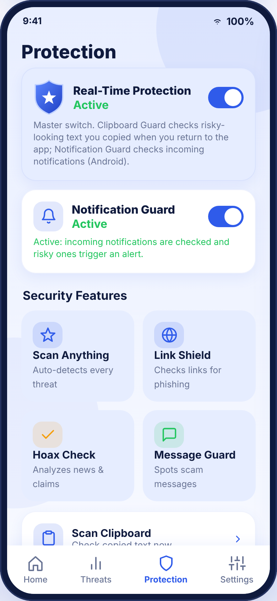

<div align="center">


# CogniShield

**Your Safe, Worry-Free Life**

Aplikasi penjaga keamanan di HP yang membantu kita tidak gampang kena tipu lewat link, pesan, dan notifikasi.


**Karya untuk Kartika Cyber Hackathon · Archard Garcia · Teknik Komputer, BINUS University**

</div>

---

## Daftar isi
1. [Coba aplikasinya (untuk Dewan Juri)](#-coba-aplikasinya-untuk-dewan-juri)
2. [Apa itu CogniShield?](#-apa-itu-cognishield)
3. [Tampilan aplikasi](#-tampilan-aplikasi)
4. [Fitur dan fungsinya](#-fitur-dan-fungsinya)
5. [Ancaman yang dikenali](#-ancaman-yang-dikenali)
6. [Cara kerja](#-cara-kerja)
7. [Menjalankan sendiri (opsional)](#-menjalankan-sendiri-opsional)
8. [Batasan yang jujur](#-batasan-yang-jujur)

---

## 📲 Coba aplikasinya (untuk Dewan Juri)

### ⚡ Mulai cepat (3 langkah, tanpa mengatur apa pun)

| # | Lakukan ini | Hasilnya |
|---|---|---|
| **1** | Dari **HP Android**, buka 👉 [**Download CogniShield.apk**](https://github.com/archardddd16/cognishield/releases/latest) dan ketuk file `CogniShield.apk` | File terunduh |
| **2** | Ketuk file APK, lalu **Pengaturan → Izinkan dari sumber ini → Instal**. Kalau muncul peringatan keamanan, pilih **Instal saja** | CogniShield terpasang |
| **3** | Buka app → tab **Protection** → **Scan Anything** → tempel contoh di bawah → **Check now** | Hasil *Waspada: Phishing*, skor ±72/100 |

Pesan contoh untuk ditempel (salin saja):

```
Akun Anda dibekukan, segera verifikasi di bit.ly/update-akun
```

Contoh link untuk mode **Link**:

```
http://klikbca-verifikasi.xyz/login
```

> ✅ Alamat server sudah tertanam di aplikasi, jadi **tidak ada pengaturan** yang perlu diubah.
> ⏳ Scan pertama bisa terasa lebih lambat beberapa detik karena server sedang "bangun". Scan berikutnya cepat.

### Kalau instalasi bermasalah

<details>
<summary><b>Muncul peringatan "tidak dapat memverifikasi developer" atau Play Protect</b></summary>

Itu normal karena aplikasi belum ada di Play Store. Pilih **Instal saja** (*Install anyway*) atau **Instal tanpa memindai**.

Kalau tombolnya tidak ada: *Play Store → ikon profil → Play Protect → ikon gerigi → matikan "Pindai aplikasi dengan Play Protect"*, pasang aplikasinya, lalu nyalakan lagi.

</details>

<details>
<summary><b>HP Samsung: gagal dengan pesan "aplikasi tidak terinstal"</b></summary>

Matikan **Auto Blocker** dulu: *Pengaturan → Keamanan dan privasi → Auto Blocker → matikan*. Setelah CogniShield terpasang, boleh dinyalakan lagi.

</details>

<details>
<summary><b>File yang terunduh berakhiran .zip atau tidak bisa dibuka</b></summary>

Pastikan yang diunduh adalah file **`CogniShield.apk`** dari halaman *Releases* (bagian **Assets**), bukan "Source code (zip)". Kalau tetap tidak bisa, unduh di laptop lalu kirim ke HP lewat kabel USB atau Google Drive.

</details>

<details>
<summary><b>App menampilkan "Cannot reach the backend"</b></summary>

1. Pastikan HP terhubung internet.
2. Buka `https://archardd16.pythonanywhere.com/health` di browser HP. Harus muncul teks status.
3. Kalau sudah muncul, tutup app lalu buka lagi dan ulangi scan.

</details>

### Mengaktifkan perlindungan otomatis (opsional)

Tab **Protection** → nyalakan **Notification Guard** → ketuk **Grant notification access** → aktifkan **CogniShield** di pengaturan Android → kembali ke aplikasi. Setelah itu, notifikasi yang terlihat berisiko akan memunculkan peringatan sendiri.

### Tanpa memasang apa pun

- 🎬 **Video tutorial:** [tonton di YouTube](ISI-LINK-YOUTUBE-DI-SINI) (cara pakai dalam 2 menit).
- 🌐 **Cek server:** [`/health`](https://archardd16.pythonanywhere.com/health) menunjukkan server aktif.

<details>
<summary><b>Tes mesin analisis lewat terminal (untuk juri yang suka teknis)</b></summary>

**Windows PowerShell:**

```powershell
Invoke-RestMethod -Method Post -Uri "https://archardd16.pythonanywhere.com/analyze/auto" `
  -ContentType "application/json" `
  -Body '{"text":"Akun Anda dibekukan, segera verifikasi di bit.ly/update-akun","source":"manual"}'
```

**macOS / Linux / Git Bash:**

```bash
curl -X POST https://archardd16.pythonanywhere.com/analyze/auto \
  -H "Content-Type: application/json" \
  -d '{"text":"Akun Anda dibekukan, segera verifikasi di bit.ly/update-akun","source":"manual"}'
```

Hasilnya berupa JSON berisi kategori ancaman, skor risiko, alasan, dan saran.

</details>

---

## 🛡️ Apa itu CogniShield?

Penipuan digital biasanya datang sebagai link palsu, pesan yang bikin kita buru-buru, atau file APK berbahaya. Kita sulit memeriksa semuanya satu-satu, dan tidak ada yang menjaga pada saat pesan itu masuk.

CogniShield memeriksa teks dan link yang kita terima, lalu memberi:

- **Skor risiko** 0 sampai 100,
- **Jenis ancamannya**,
- **Alasan** kenapa dianggap berbahaya,
- **Saran** apa yang sebaiknya dilakukan.

Ancaman ini juga relevan bagi personel dan keluarga satuan: pesan yang mengatasnamakan instansi, pembajakan akun, link dan APK berbahaya, serta hoaks.

---

## 📱 Tampilan aplikasi

> Gambar di bawah adalah rekonstruksi tampilan layar aplikasi.

<table>
  <tr>
    <td align="center"><br><b>Home</b><br><sub>Status, Security Score, ancaman terbaru</sub></td>
    <td align="center"><br><b>Scan pesan</b><br><sub>Hasil, alasan, dan saran</sub></td>
    <td align="center"><br><b>Cek link</b><br><sub>Domain tiruan bank, skor 95</sub></td>
  </tr>
  <tr>
    <td align="center"><br><b>Protection</b><br><sub>Perlindungan otomatis</sub></td>
    <td align="center"><br><b>Threat Feed</b><br><sub>Riwayat ancaman</sub></td>
    <td align="center"><br><b>Risk Graph</b><br><sub>Ringkasan semua scan</sub></td>
  </tr>
</table>

---

## ✨ Fitur dan fungsinya

| Fitur | Untuk apa |
|---|---|
| 🏠 **Home / Security Score** | Menunjukkan status perlindungan dan skor keamanan 0 sampai 100 dari scan terakhir, plus daftar ancaman terbaru. |
| 🔍 **Scan Anything** | Tempel apa saja (pesan, link, berita). Aplikasi menentukan sendiri jenis ancamannya. |
| 🔗 **Link Shield** | Mengecek link dari pola domainnya (pemendek URL, domain tiruan bank, akhiran berisiko, unduhan APK) **tanpa membuka link**. |
| 💬 **Message Guard** | Mengenali pesan penipuan: minta OTP, hadiah palsu, ancaman akun diblokir, dan sejenisnya. |
| 📰 **Hoax Check** | Menganalisis berita atau klaim viral yang terindikasi hoaks atau propaganda. |
| 📋 **Clipboard Guard** | Mengecek teks yang baru kita salin saat aplikasi dibuka lagi. Hanya teks yang berisiko yang dikirim ke server. |
| 🔔 **Notification Guard** *(Android)* | Membaca notifikasi masuk (misalnya WhatsApp) dan langsung memberi peringatan kalau terlihat berbahaya. |
| 📊 **Threat Feed** | Menyimpan semua ancaman, bisa disaring: Blocked, Detected, Resolved. |
| 🌐 **Risk Graph** | Grafik semua hasil scan: biru aman, kuning mencurigakan, merah berbahaya. |

**Mengaktifkan Notification Guard:** tab *Protection* → nyalakan **Notification Guard** → ketuk **Grant notification access** → aktifkan **CogniShield** di pengaturan Android → kembali ke aplikasi. Fitur ini khusus Android, karena iOS tidak mengizinkan aplikasi membaca notifikasi aplikasi lain.

---

## 🎯 Ancaman yang dikenali

18 jenis: Phishing · Pencurian OTP dan data pribadi · Pembajakan akun (WhatsApp "kode salah kirim", QR) · Malware/APK · Hadiah dan bansos palsu · Investasi/kripto palsu · Judi online · Pinjol ilegal · Lowongan kerja palsu · Pencatutan polisi/bank/instansi · Paket/kurir palsu · "Ini nomor baru saya" · Pemerasan/ransomware · CS dan layanan palsu · Penipuan jual-beli · Asmara/warisan · Hoaks/propaganda · Tautan berbahaya.

---

## ⚙️ Cara kerja

```
 App Flutter ──┐
 Clipboard Guard ──┼──►  Backend FastAPI  ──►  Mesin aturan (107 aturan, 18 kategori)
 Notification Guard ┘     /analyze/auto          + analisis URL + skor risiko + saran
```

1. **Normalisasi** teks (Unicode NFKC) supaya huruf hias tidak mengelabui.
2. **Pencocokan aturan** (107 aturan dalam 18 kategori).
3. **Penguat tekanan**: kata yang bikin buru-buru atau mengancam menaikkan skor.
4. **Analisis URL** dari pola domain.
5. **Skor akhir**: Aman (< 30), Waspada (≥ 30), Bahaya (≥ 60), disertai alasan dan saran.

Pendekatan berbasis aturan dipilih karena cepat (sekitar 0,4 ms per analisis di mesin pengembangan, di luar jaringan), setiap hasilnya bisa dijelaskan, dan tidak butuh data latih atau GPU. Tempat pemasangan model IndoBERT sudah disiapkan untuk pengembangan berikutnya.

**Privasi:** link tidak pernah dibuka, teks hanya dikirim ke server milik pengembang, dan hasil aman dari clipboard/notifikasi tidak dicatat.

---

## 🧰 Menjalankan sendiri (opsional)

```
cognishield/
├── backend/   FastAPI + mesin analisis
└── app/       Aplikasi Flutter
```

**Backend** (PowerShell):

```powershell
cd cognishield/backend
python -m venv .venv
Set-ExecutionPolicy -Scope Process -ExecutionPolicy Bypass
.\.venv\Scripts\Activate.ps1
pip install -r requirements.txt
python test_analyzer.py          # 8 tes otomatis
python -m uvicorn main:app --host 0.0.0.0 --port 8000 --reload
```

Dokumentasi API: <http://127.0.0.1:8000/docs>

**Aplikasi:**

```powershell
cd cognishield/app
flutter create . --project-name cognishield --platforms=web,android   # sekali saja
flutter pub get
flutter run -d chrome
```

Untuk Android (Notification Guard): jalankan `.\setup_android.ps1` sekali, lalu `flutter run`. Alamat server bisa diubah di **Settings → Backend Server**.

**Endpoint utama:** `POST /analyze/auto` · `/analyze/url` · `/analyze/notification` · `/analyze/propaganda` · `GET /stats` · `/history` · `/categories` · `DELETE /history`.

---

## ⚠️ Batasan yang jujur

- Mesin berbasis **aturan dan pola**, belum model machine learning. Penipuan baru dengan gaya bahasa lain bisa lolos, dan pesan sah yang mirip penipuan bisa ditandai. Hasilnya **skor risiko, bukan kepastian**.
- Link **tidak dibuka** dan belum dicek ke database reputasi (mis. Google Safe Browsing).
- Notification Guard hanya di **Android** dan butuh izin *Notification Access*.
- Riwayat disimpan di memori server dan hilang saat server restart.

**Rencana berikutnya:** model IndoBERT untuk hoaks, integrasi Google Safe Browsing, riwayat permanen, dan fitur berbagi untuk iOS.

---

<div align="center">

Dibuat oleh **Archard Garcia** · Teknik Komputer, BINUS University<br>
*CogniShield. Your Safe, Worry-Free Life.*

</div>
