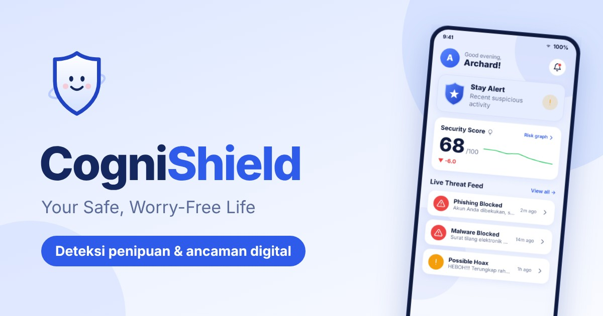
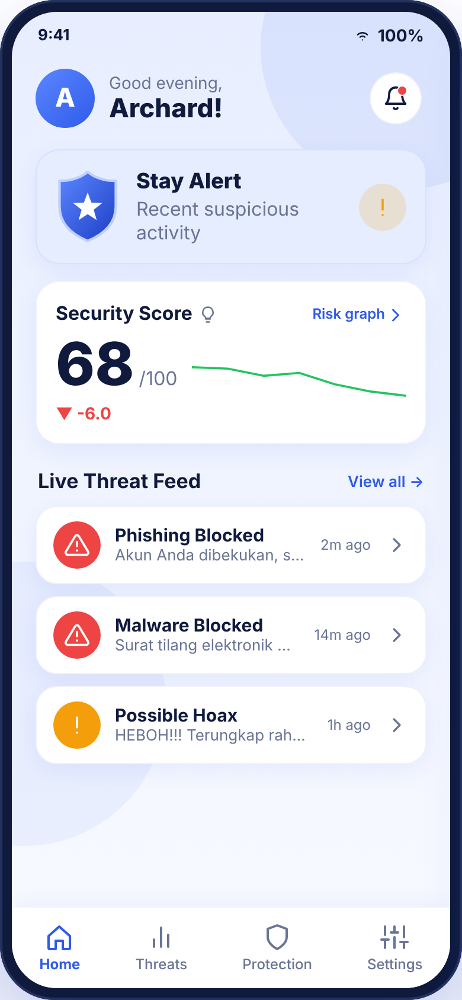
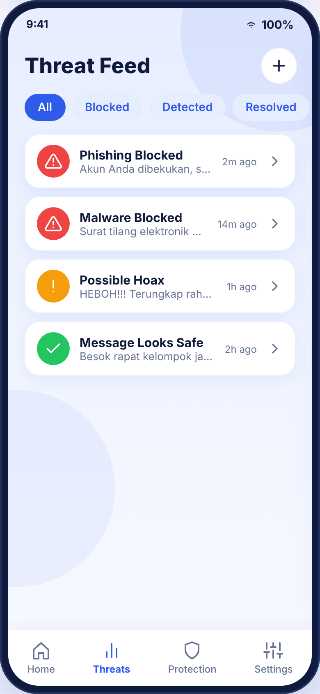
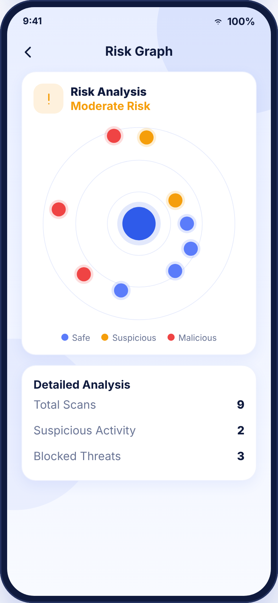

<div align="center">


# CogniShield

**Your Safe, Worry-Free Life**

Aplikasi penjaga keamanan di HP yang membantu kita tidak gampang kena tipu lewat link, pesan, dan notifikasi.




**Karya untuk Kartika Cyber Hackathon · Archard Garcia · Teknik Komputer, BINUS University**

</div>

---

## Daftar isi
1. [Coba aplikasinya (untuk Dewan Juri)](#-coba-aplikasinya-untuk-dewan-juri)
2. [Apa itu CogniShield?](#-apa-itu-cognishield)
3. [Tampilan aplikasi](#-tampilan-aplikasi)
4. [Fitur dan fungsinya](#-fitur-dan-fungsinya)
5. [Ancaman yang dikenali](#-ancaman-yang-dikenali)
6. [Cara kerja](#-cara-kerja)
7. [Struktur proyek dan API](#-struktur-proyek-dan-api)
8. [Batasan yang jujur](#-batasan-yang-jujur)

---

## 📲 Coba aplikasinya (untuk Dewan Juri)

CogniShield terdiri dari **aplikasi Android** dan **server analisis** (Python). Servernya dijalankan di laptop sendiri, jadi teks yang dianalisis **tidak keluar ke layanan pihak ketiga**. Ada tiga langkah, sekitar 10 menit.

**Yang dibutuhkan:** laptop dengan **Python 3.10 atau lebih baru** ([unduh di python.org](https://www.python.org/downloads/), centang *Add Python to PATH*), HP Android, dan **Wi-Fi yang sama** untuk keduanya.

### Langkah 1. Jalankan server di laptop

1. Di halaman GitHub ini, klik tombol hijau **Code → Download ZIP**, lalu ekstrak.
2. Buka **PowerShell** di dalam folder hasil ekstrak, lalu jalankan:

```powershell
cd cognishield\backend
python -m venv .venv
Set-ExecutionPolicy -Scope Process -ExecutionPolicy Bypass
.\.venv\Scripts\Activate.ps1
pip install -r requirements.txt
python -m uvicorn main:app --host 0.0.0.0 --port 8000
```

3. Kalau Windows Firewall bertanya, pilih **Allow access** (jaringan privat).
4. Cek alamat laptop: buka PowerShell baru, ketik `ipconfig`, dan catat **IPv4 Address** Wi-Fi (misalnya `192.168.1.10`).
5. Tes dari browser HP: buka `http://192.168.1.10:8000/health` (ganti dengan IP laptop). Kalau muncul teks status, server siap.

<details>
<summary><b>macOS / Linux</b></summary>

```bash
cd cognishield/backend
python3 -m venv .venv && source .venv/bin/activate
pip install -r requirements.txt
python -m uvicorn main:app --host 0.0.0.0 --port 8000
```

Cek IP dengan `ipconfig getifaddr en0` (macOS) atau `hostname -I` (Linux).

</details>

### Langkah 2. Pasang aplikasi di HP

👉 [**Download CogniShield.apk**](https://github.com/archardddd16/cognishield/releases/latest) (buka dari HP, ketuk `CogniShield.apk` di bagian **Assets**)

1. Ketuk file APK. Kalau diminta, aktifkan **Izinkan dari sumber ini**.
2. Kalau muncul peringatan keamanan atau *"tidak dapat memverifikasi developer"*, pilih **Instal saja** (*Install anyway*). Itu normal karena aplikasi belum ada di Play Store.

### Langkah 3. Sambungkan ke server dan coba

1. Buka CogniShield → **Settings → Backend Server**, isi `http://IP-LAPTOP:8000` (contoh `http://192.168.1.10:8000`), lalu simpan.
2. Tab **Protection → Scan Anything**, tempel pesan contoh ini, lalu ketuk **Check now**:

```
Akun Anda dibekukan, segera verifikasi di bit.ly/update-akun
```

3. Hasilnya harus **Waspada: Phishing / Pencurian Akun** dengan skor sekitar **72/100**, lengkap dengan alasan dan saran.
4. Coba juga mode **Link** dengan `http://klikbca-verifikasi.xyz/login` (skor sekitar **95/100**). Link ini **tidak pernah dibuka** oleh aplikasi.

### Kalau ada kendala

<details>
<summary><b>App menampilkan "Cannot reach the backend"</b></summary>

- Server di laptop harus masih berjalan (jendela PowerShell jangan ditutup).
- HP dan laptop harus di **Wi-Fi yang sama** (bukan data seluler). Matikan "Isolasi AP" atau jaringan tamu di router kalau ada.
- Alamat harus memakai **IP laptop** dan diawali `http://`, bukan `127.0.0.1`.
- Izinkan port 8000 di Windows Firewall. PowerShell sebagai Administrator:
  `New-NetFirewallRule -DisplayName "CogniShield" -Direction Inbound -Protocol TCP -LocalPort 8000 -Action Allow`
- Tes dulu `http://IP-LAPTOP:8000/health` di browser HP.

</details>

<details>
<summary><b>Peringatan Play Protect memblokir instalasi</b></summary>

Pilih **Instal tanpa memindai**. Kalau tombolnya tidak ada: *Play Store → ikon profil → Play Protect → ikon gerigi → matikan "Pindai aplikasi dengan Play Protect"*, pasang aplikasinya, lalu nyalakan lagi.

</details>

<details>
<summary><b>HP Samsung: gagal dengan pesan "aplikasi tidak terinstal"</b></summary>

Matikan **Auto Blocker** dulu: *Pengaturan → Keamanan dan privasi → Auto Blocker → matikan*. Setelah CogniShield terpasang, boleh dinyalakan lagi.

</details>

<details>
<summary><b>File yang terunduh berakhiran .zip atau tidak bisa dibuka</b></summary>

Pastikan yang diunduh adalah **`CogniShield.apk`** dari halaman *Releases* (bagian **Assets**), bukan "Source code (zip)".

</details>

### Mengaktifkan perlindungan otomatis (opsional)

Tab **Protection** → nyalakan **Notification Guard** → ketuk **Grant notification access** → aktifkan **CogniShield** di pengaturan Android → kembali ke aplikasi. Setelah itu, notifikasi yang terlihat berisiko memunculkan peringatan sendiri.

### Tanpa memasang apa pun

- 🎬 **Video tutorial:** [tonton di YouTube](ISI-LINK-YOUTUBE-DI-SINI) (cara pakai dalam 2 menit).
- 🧪 **Tes mesin di laptop saja** (setelah Langkah 1): jalankan `python test_analyzer.py` di folder `backend` untuk 13 tes otomatis, atau buka `http://127.0.0.1:8000/docs` di browser laptop untuk mencoba API langsung.

<details>
<summary><b>Tes mesin analisis lewat terminal</b></summary>

```powershell
Invoke-RestMethod -Method Post -Uri "http://127.0.0.1:8000/analyze/auto" `
  -ContentType "application/json" `
  -Body '{"text":"Akun Anda dibekukan, segera verifikasi di bit.ly/update-akun","source":"manual"}'
```

Hasilnya JSON berisi kategori ancaman, skor risiko, alasan, dan saran.

</details>

---

## 🛡️ Apa itu CogniShield?

Penipuan digital biasanya datang sebagai link palsu, pesan yang bikin kita buru-buru, atau file APK berbahaya. Kita sulit memeriksa semuanya satu-satu, dan tidak ada yang menjaga pada saat pesan itu masuk.

CogniShield memeriksa teks dan link yang kita terima, lalu memberi:

- **Skor risiko** 0 sampai 100,
- **Jenis ancamannya**,
- **Alasan** kenapa dianggap berbahaya,
- **Saran** apa yang sebaiknya dilakukan.

Ancaman ini juga relevan bagi personel dan keluarga satuan: pesan yang mengatasnamakan instansi, pembajakan akun, link dan APK berbahaya, serta hoaks.

---

## 📱 Tampilan aplikasi

> Gambar di bawah adalah rekonstruksi tampilan layar aplikasi.

<table>
  <tr>
    <td align="center"><br><b>Home</b><br><sub>Status, Security Score, ancaman terbaru</sub></td>
    <td align="center"><br><b>Scan pesan</b><br><sub>Hasil, alasan, dan saran</sub></td>
    <td align="center"><br><b>Cek link</b><br><sub>Domain tiruan bank, skor 95</sub></td>
  </tr>
  <tr>
    <td align="center"><br><b>Protection</b><br><sub>Perlindungan otomatis</sub></td>
    <td align="center"><br><b>Threat Feed</b><br><sub>Riwayat ancaman</sub></td>
    <td align="center"><br><b>Risk Graph</b><br><sub>Ringkasan semua scan</sub></td>
  </tr>
</table>

---

## ✨ Fitur dan fungsinya

| Fitur | Untuk apa |
|---|---|
| 🏠 **Home / Security Score** | Menunjukkan status perlindungan dan skor keamanan 0 sampai 100 dari scan terakhir, plus daftar ancaman terbaru. |
| 🧠 **Panel Lapisan Pertahanan** | Di setiap hasil scan: lapisan mana yang menemukan sinyal, taktik manipulasi yang terdeteksi, dan tingkat keyakinan. |
| 🔍 **Scan Anything** | Tempel apa saja (pesan, link, berita). Aplikasi menentukan sendiri jenis ancamannya. |
| 🔗 **Link Shield** | Mengecek link dari pola domainnya (pemendek URL, domain tiruan bank, akhiran berisiko, unduhan APK) **tanpa membuka link**. |
| 💬 **Message Guard** | Mengenali pesan penipuan: minta OTP, hadiah palsu, ancaman akun diblokir, dan sejenisnya. |
| 📰 **Hoax Check** | Menganalisis berita atau klaim viral yang terindikasi hoaks atau propaganda. |
| 📋 **Clipboard Guard** | Mengecek teks yang baru kita salin saat aplikasi dibuka lagi. Hanya teks yang berisiko yang dikirim ke server. |
| 🔔 **Notification Guard** *(Android)* | Membaca notifikasi masuk (misalnya WhatsApp) dan langsung memberi peringatan kalau terlihat berbahaya. |
| 📊 **Threat Feed** | Menyimpan semua ancaman, bisa disaring: Blocked, Detected, Resolved. |
| 🌐 **Risk Graph** | Grafik semua hasil scan: biru aman, kuning mencurigakan, merah berbahaya. |

**Mengaktifkan Notification Guard:** tab *Protection* → nyalakan **Notification Guard** → ketuk **Grant notification access** → aktifkan **CogniShield** di pengaturan Android → kembali ke aplikasi. Fitur ini khusus Android, karena iOS tidak mengizinkan aplikasi membaca notifikasi aplikasi lain.

---

## 🎯 Ancaman yang dikenali

18 jenis: Phishing · Pencurian OTP dan data pribadi · Pembajakan akun (WhatsApp "kode salah kirim", QR) · Malware/APK · Hadiah dan bansos palsu · Investasi/kripto palsu · Judi online · Pinjol ilegal · Lowongan kerja palsu · Pencatutan polisi/bank/instansi · Paket/kurir palsu · "Ini nomor baru saya" · Pemerasan/ransomware · CS dan layanan palsu · Penipuan jual-beli · Asmara/warisan · Hoaks/propaganda · Tautan berbahaya.

---

## ⚙️ Cara kerja

```
 App Flutter ───────┐
 Clipboard Guard ───┼──►  Backend FastAPI  ──►  7 lapisan pertahanan  ──►  skor + alasan + saran + keyakinan
 Notification Guard ┘     /analyze/auto
```

CogniShield memakai **pertahanan berlapis (defense in depth)**. Setiap lapisan memeriksa hal yang berbeda dan melapor sendiri-sendiri:

| # | Lapisan | Memeriksa apa |
|---|---|---|
| 1 | **Normalisasi** | Huruf hias (Unicode NFKC) dan karakter tak terlihat yang dipakai untuk mengelabui filter. |
| 2 | **Pola ancaman** | 107 aturan dalam 18 kategori, plus penguat tekanan (urgensi, ancaman). |
| 3 | **Domain kognitif** | **Taktik manipulasi** yang dipakai penipu: tekanan waktu, mengaku otoritas, rasa takut, iming-iming hadiah, kelangkaan, kerahasiaan, bukti sosial palsu, dan kedekatan palsu. Berdasarkan prinsip persuasi dari psikologi sosial. |
| 4 | **Analisis tautan** | Pemendek URL, alamat IP, punycode, akhiran berisiko, hosting gratis, unduhan `.apk`, domain tiruan merek. Tautan tidak dibuka. |
| 5 | **Klaim vs tautan** | Pesan menyebut sebuah lembaga (mis. BCA, JNE, Shopee), tetapi tautannya bukan milik lembaga itu. |
| 6 | **Reputasi eksternal (VirusTotal, opsional)** | Memastikan tautan **benar-benar** ditandai berbahaya oleh mesin keamanan lain, bukan hanya dari gaya bahasa. Aktif bila server punya API key VirusTotal; tanpa key, lapisan ini tampil "belum diaktifkan". |
| 7 | **Model bahasa (opsional)** | Tempat pemasangan model seperti IndoBERT sudah disiapkan. **Saat ini belum dilatih dan belum aktif**, dan aplikasi menampilkannya sebagai "belum diaktifkan". |

**Skor akhir:** Aman (< 30), Waspada (≥ 30), Bahaya (≥ 60), disertai alasan dan saran.

**Tingkat keyakinan** dihitung dari berapa lapisan aktif yang sepakat: tiga atau lebih = tinggi, dua = sedang, satu = rendah. Ini ukuran heuristik berdasarkan kesepakatan antar-lapisan, **bukan probabilitas statistik** dan belum dikalibrasi dengan data berlabel.

Di aplikasi, tiap hasil scan menampilkan panel **Lapisan pertahanan** (lapisan mana yang berbunyi) dan **Taktik manipulasi** yang terdeteksi beserta potongan teks buktinya.

Pendekatan berbasis aturan dipilih karena cepat (sekitar 0,4 ms per analisis di mesin pengembangan, di luar jaringan), setiap hasilnya bisa dijelaskan, dan tidak butuh data latih atau GPU.

**Cek tautan dengan VirusTotal (opsional).** Hasil VirusTotal menetapkan *skor minimum*: 5 mesin atau lebih menandai berbahaya = Bahaya (90), 2-4 mesin = Bahaya (65), 1 mesin atau 2 "mencurigakan" = Waspada (35). Hasil bersih **tidak pernah menurunkan** skor lokal. Cara mengaktifkan, sebelum menjalankan server:

```powershell
$env:VT_API_KEY = "isi-api-key-virustotal-kamu"
python -m uvicorn main:app --host 0.0.0.0 --port 8000
```

API key gratis dari akun [virustotal.com](https://www.virustotal.com) (menu profil → API key). Jangan pernah menaruh key di kode atau di GitHub. Cek aktif atau tidaknya di `/health` (`"virustotal": true`). Akun gratis dibatasi 4 permintaan/menit dan 500/hari untuk pemakaian non-komersial. Tautan yang baru pertama kali dilihat VirusTotal butuh beberapa detik, jadi hasilnya bisa "masih dianalisis" dan muncul saat dipindai ulang. Jika VirusTotal tidak terjangkau atau kuota habis, CogniShield tetap jalan dengan mesin lokal.

**Privasi:** tautan tidak pernah dibuka oleh aplikasi. Teks hanya dikirim ke server yang dijalankan sendiri. Jika VirusTotal diaktifkan, **hanya alamat tautan** (bukan isi pesan) dikirim ke VirusTotal, dan VirusTotal dapat menyimpan atau membagikan alamat itu. Hasil aman dari clipboard/notifikasi tidak dicatat.

---

## 🧰 Struktur proyek dan API

```
cognishield/
├── backend/   FastAPI + mesin analisis
└── app/       Aplikasi Flutter
```

Untuk membangun aplikasi dari kode (opsional): `cd cognishield/app`, `flutter create . --project-name cognishield --platforms=web,android` (sekali saja), `flutter pub get`, `flutter run -d chrome`. Di Android, jalankan `.\setup_android.ps1` sekali untuk memasang modul Notification Guard.

**Endpoint utama:** `POST /analyze/auto` · `/analyze/url` · `/analyze/notification` · `/analyze/propaganda` · `GET /health` · `/stats` · `/history` · `/categories` · `DELETE /history`.

---

## ⚠️ Batasan yang jujur

- Mesin berbasis **aturan, pola, dan heuristik**; belum ada model machine learning yang dilatih (slot IndoBERT sudah disiapkan tetapi belum aktif). Penipuan baru dengan gaya bahasa lain bisa lolos, dan pesan sah yang mirip penipuan bisa ditandai. Hasilnya **skor risiko, bukan kepastian**.
- Link **tidak dibuka**. Tanpa API key VirusTotal, tautan hanya dinilai dari pola domain; dengan key, hasil bergantung pada kuota gratis dan pada tautan yang sudah dikenal VirusTotal. Belum diuji langsung ke layanan VirusTotal di lingkungan pengembangan ini (hanya dengan simulasi), jadi coba dulu dengan key milikmu.
- Notification Guard hanya di **Android** dan butuh izin *Notification Access*.
- Riwayat disimpan di memori server dan hilang saat server restart.

**Rencana berikutnya:** model IndoBERT untuk hoaks, integrasi Google Safe Browsing, riwayat permanen, dan fitur berbagi untuk iOS.

---

<div align="center">

Dibuat oleh **Archard Garcia** · Teknik Komputer, BINUS University<br>
*CogniShield. Your Safe, Worry-Free Life.*

</div>
